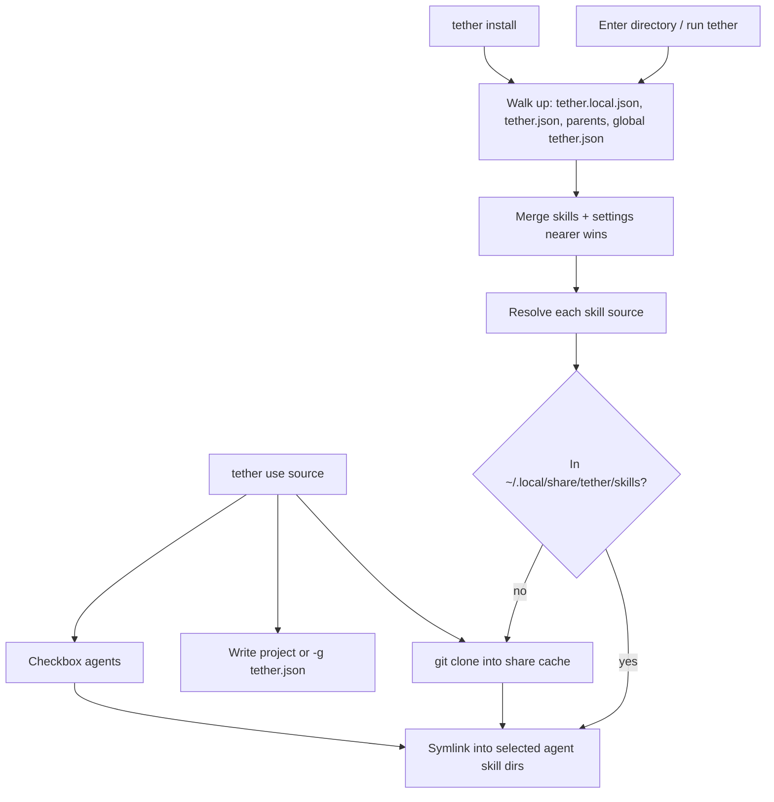

# Tether — Agent Skill Management CLI

## Goals

A Go binary named `tether` that:

- Keeps a **canonical skill install cache** under `~/.local/share/tether/skills/`
- Declares **active** skills in hierarchical JSON config
- Separates **install** (fetch into cache) from **use** (install + write config + activate/link)
- Defaults to **project** activation; `-g` writes the **global** config
- Wires skills into **AI agents** via symlinks (checkbox prompt; defaults **cursor** + **agents**)
- Supports **search** via skills.sh (`npx skills find` API) and install from GitHub sources

## Layout

```
~/.local/share/tether/
  skills/
    <skill-name>/
      SKILL.md
      ...

~/.config/tether/
  tether.json                 # global active skills + settings

<project>/
  tether.json                 # project active skills (committed)
  tether.local.json           # optional personal overrides (gitignore)
  .agents/skills/<name> -> ~/.local/share/tether/skills/<name>
  .cursor/skills/<name>  -> ~/.local/share/tether/skills/<name>
  .claude/skills/<name>  -> ...   # if agent selected
```

A skill in the cache is **not active** until it appears in config for the current directory hierarchy. `use` does both; `install` only ensures the cache (and re-links what’s already declared).

## Config discovery

Walk **up from cwd** to `/` (or a ceiling path), collect configs, **merge** with nearer overriding farther:

1. `tether.local.json` (highest precedence in a directory; not committed)
2. `tether.json`
3. … parents …
4. `~/.config/tether/tether.json` (global baseline)

When **writing**:

- Default: create/update `./tether.json` (shared project file)
- `-g` / `--global`: write `~/.config/tether/tether.json`
- Optional later: `--path`, or write `tether.local.json` via a dedicated flag

No `scope` field and no `projects: ["/abs/path"]` list. **Active in this project** = listed in a `tether.json` found for this tree. **Active globally** = listed in global `tether.json`.

## Config schemas (JSON)

**Global** `~/.config/tether/tether.json`:

```json
{
  "version": 1,
  "settings": {
    "defaultAgents": ["cursor", "agents"]
  },
  "skills": {
    "frontend-design": {
      "source": "vercel-labs/agent-skills@frontend-design",
      "agents": ["cursor", "agents"]
    },
    "pr-review": {
      "github": "https://github.com/acme/skills",
      "ref": "main",
      "subdir": "skills/pr-review",
      "agents": ["cursor", "agents", "claude-code"]
    }
  }
}
```

**Project** `tether.json`:

```json
{
  "version": 1,
  "settings": {
    "agents": ["cursor", "agents"]
  },
  "skills": {
    "frontend-design": {
      "source": "vercel-labs/agent-skills@frontend-design",
      "agents": ["cursor", "agents"]
    }
  }
}
```

Notes:

- `skills` entries declare what should be **active** in this config layer.
- Install bodies always live under `~/.local/share/tether/skills/<name>/`.
- Per-skill `agents` overrides `settings.agents` / `settings.defaultAgents`.
- `source` may be shorthand (`owner/repo@skill`) or expanded `github` / `ref` / `subdir` fields.

## Commands (v1)

| Command | Behavior |
| --- | --- |
| `tether use <source> [-g] [--skill] [--agent] [-y]` | Install into share cache if missing → write config (project `tether.json` or `-g` global) → agent checkbox → symlink activate. |
| `tether install [name…]` | Read merged config for cwd; clone any missing skills into share; (re)link agents for active skills. Does **not** add new skills to config. |
| `tether unuse <name> [-g]` | Remove from project or global config; unlink agent symlinks for that layer. Keep cache if still referenced elsewhere. |
| `tether ls` | List active skills in current context (merged config) + cache status + linked agents. |
| `tether ls-cache` | List everything in `~/.local/share/tether/skills` whether active or not. |
| `tether search [query]` | Query `https://skills.sh/api/search` (same as `npx skills find`). |
| `tether upgrade [names…]` | `git pull` / re-fetch cache dirs for selected or all active skills; refresh symlinks. |

Aliases: `tether u` → `use`, `tether i` → `install`.

Source formats for `use`:

- `owner/repo`
- `owner/repo@skill-name`
- `https://github.com/owner/repo`
- `https://github.com/owner/repo/tree/<ref>/path/to/skill`

## Agent targeting

On `use` / first `install` link (TTY, no `-y` / no `--agent`): **checkbox multi-select**.

**Defaults checked:** `cursor`, `agents`

**Also offered:** `claude-code`, `codex`, `opencode`, `windsurf`, `continue`, `github-copilot`, `gemini-cli`, `cline`, `roo`, … (skills.sh agent table)

Non-interactive: `--agent cursor,agents`, `-y` (defaults), `--agent '*'`.

### Agent → path map

Symlink target is always `~/.local/share/tether/skills/<name>`. Paths follow the [vercel-labs/skills](https://github.com/vercel-labs/skills) agent table:

| Agent id | Project path | Global path |
| --- | --- | --- |
| `agents` | `.agents/skills/` | `~/.agents/skills/` |
| `cursor` | `.cursor/skills/` | `~/.cursor/skills/` |
| `claude-code` | `.claude/skills/` | `~/.claude/skills/` |
| `codex` | `.agents/skills/` | `~/.codex/skills/` |
| `opencode` | `.agents/skills/` | `~/.config/opencode/skills/` |
| … | (full table in `internal/agents`) | … |

Dedupe by destination path when multiple agents share one dir. Project `use` → project paths; `-g` → global paths.

## Resolution flow



## Architecture (Go)

```
cmd/tether/main.go
internal/cli/          # cobra: use, install, unuse, ls, search, upgrade
internal/config/       # discover/merge/write JSON
internal/store/        # ~/.local/share/tether/skills clone/update
internal/agents/       # agent id → project/global paths
internal/link/         # symlink activate/deactivate
internal/prompt/       # checkbox multi-select
internal/search/       # skills.sh /api/search
internal/source/       # parse owner/repo@skill, URLs
```

**Dependencies:** Cobra; standard `encoding/json`; `charmbracelet/huh` (or similar) for checkboxes; `net/http` for search; shell out to `git`.

**Skill discovery in a repo:** `SKILL.md` at root or `skills/<name>/SKILL.md` (+ one nested catalog level). Multiple skills without `--skill` → list / require selection (`-y` can install all when explicit).

## Implementation order

1. Module scaffold + XDG paths (`config` + `data`/`share`)
2. JSON config discover / merge / write (`tether.json`, `tether.local.json`, global `tether.json`)
3. Store clone/update under `~/.local/share/tether/skills`
4. Agent registry + symlink activation
5. Checkbox prompt (`cursor` + `agents` default)
6. `use` / `install` / `unuse` / `ls`
7. `search` + `upgrade` + README

## Defaults / decisions locked in

- **Language:** Go
- **Workflow:** shared install cache + hierarchical config + `use` vs `install` + `-g` for global
- **Config format:** JSON (`tether.json` / `~/.config/tether/tether.json`)
- **Install cache:** `~/.local/share/tether/skills/`
- **Default activation:** project `tether.json`; global only with `-g`
- **Default agents:** `cursor` + `agents` (checkboxes for others)
- **Search:** skills.sh public `/api/search`
- **No** `scope` / `projects` absolute-path lists

## Out of scope for v1

- Lockfiles, skill dependencies, shell hooks
- Interactive fzf search TUI
- Copy mode unless symlinks fail
- Authenticated skills.sh v1 API / OIDC
- Auto-detect installed agents to reorder checkboxes

## Implementation todos

1. Go module scaffold; XDG config + share paths
2. Hierarchical JSON config (discover, merge, write)
3. Skill cache under `~/.local/share/tether/skills` (clone/update)
4. Agent registry + destination-deduped symlinks
5. Checkbox prompt (cursor + agents default)
6. `use`, `install`, `unuse`, `ls`
7. `search`, `upgrade`, README
